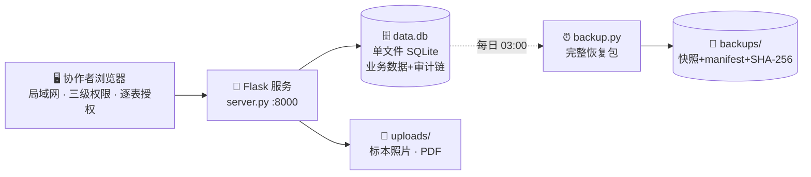

<div align="center">

# 标本信息管理系统 · Specimens Manager

_把实验室的标本台账从一堆 Excel，变成一个多人协作、全程可追溯的网页数据库。_

[](LICENSE)
[](https://www.python.org)
[](https://flask.palletsprojects.com)
[](https://www.sqlite.org)
[](#-快速开始)

**English**: A self-hosted, multi-user web database for natural-history specimen & molecular-lab
collections — Excel-like grid editing, row-level versioning and undo, hash-chained audit log,
nomenclator-integrated taxonomy fields, attachments, loans, and automated backups.
Python/Flask + SQLite, deployable on a single machine in minutes.

</div>

---

> **为谁而做**：为标本馆与分类学实验室开发，已在生产环境稳定运行，管理数千条标本与分子实验记录。
> 数据表完全可定制，换个类群、换个实验室照样能用（见 [🧬 定制数据表](#-定制数据表)）。



## ✨ 功能特性

| | 特性 | 一句话说明 |
|---|---|---|
| 📝 | **Excel 手感编辑** | 双击进格、方向键移动、Ctrl+C 复制；筛选/排序/冻结列/列宽，"我的视图"保存整套布局 |
| 👥 | **多人协作** | 管理员 → 类群管理员 → 学生三级权限，逐表授权；行级乐观锁，冲突按字段三方合并 |
| 🧬 | **名录联动** | 属名输入即联想内置国际分类名录，目/科/亚科/族/亚族自动带出；最终名校验收录状态、异名自动转接受名；名录数据源可替换 |
| 🔗 | **关联带出** | 采集事件号一键带出 22 个采集字段，改源表全表同步；分子文库 ⇄ DNA 提取台账鉴定联动 |
| 🔍 | **数据体检** | 地名标准化、日期/坐标/浓度类型化解析；规则引擎产出问题工单，一键纠错带 before/after |
| 🕰️ | **全程可追溯** | 哈希链审计日志、撤销/重做逐行精确回退、版本快照可保护"投稿前"版本、回收站 |
| 📥 | **两段式导入** | 先预览逐行"旧值→新值"，确认后才执行；空单元格=保持原值；导出自带数据字典 |
| 📎 | **附件与流转** | 拖拽/粘贴截图上传、规范命名、SHA-256 校验；借出归还台账、盒位示意图 |
| 🗂️ | **项目工作集** | 跨表记录纳入研究项目，冻结导出，不动主库一根毫毛 |
| 🔧 | **运维自动化** | 每日完整恢复包（快照+manifest+SHA-256）、开机自启、崩溃自动重启 |

## 🚀 快速开始

### Windows（单机，适合小组实验室）

```bat
:: 1. 安装 Python 3.10+（勾选 Add to PATH）
:: 2. 克隆本仓库，进入目录：
pip install -r requirements.txt
start.bat
```

浏览器自动打开 `http://127.0.0.1:8000`，**注册的第一个账号自动成为管理员**。
局域网协作者访问启动窗口显示的 `http://<你的IP>:8000`（首次启动在防火墙弹窗中允许「专用网络」）。

> 运行 `setup_tasks.bat` 可配置**开机自启**与**每日 03:00 自动备份**；`uninstall_tasks.bat` 取消。

### Linux 服务器（生产推荐）

```bash
sudo git clone https://github.com/ZyYang0124/Specimens-Manager.git /opt/specimen-manager
cd /opt/specimen-manager
sudo bash deploy/deploy.sh
```

一条命令完成：venv → 依赖 → systemd 服务（崩溃自动重启）→ 每日备份 timer。
访问 `http://服务器IP:8000` 即可。

### 导入历史数据

进入各表 →「导入 Excel」（合并模式，导入前自动快照，可整体撤销）；表头模板用工具栏「导出表头」下载，
在 Excel 里按列名填好后合并导入，保证列全部识别。

## 🧬 定制数据表

表结构不是写死的——`tables_def.py` 是唯一的表结构注册表，扩一张新表只需三步：

1. **复制**文件末尾的示例表段，改 `label`（页签名）和列定义；
2. **重启**服务，新页签自动出现——编辑/筛选/版本/导入导出/附件/回收站/变更历史全部自动生效；
3. **导入**数据，完成。

每张表可配置业务主键、关联带出（`linked_source`）、名录联想（`genus_lookup`）、地名标准化、
字段分组排版等，现有各表即现成模板。

> **换个类群？** 名录联想按表开关（`genus_lookup`），默认数据源为内置国际名录；
> 可参照自带的 `update_*.py` 更新脚本，改造为对接你们类群的名录
> （如 Catalogue of Life、FishBase、IPNI 等任一学名数据源）。

## 💾 备份与恢复

- 所有业务数据就在 **`data.db` 一个文件 + `uploads/` 附件目录**——备份=复制它们。
- `backup.py` 生成**完整恢复包**：SQLite 一致性快照 + 附件副本 + manifest（表计数/SHA-256/附件清单），
  写完校验才原子发布，半成品永远不会进入可恢复列表。
- 留存策略在 `config.py`：份数 / 容量上限 / 异地副本目录。未配置异地目录时，系统会如实标注
  「不构成可靠的异地备份」。
- 管理员下载的备份包自动剥离会话与 API 令牌（口令只存哈希）。

## ⚙️ 配置

集中在 `config.py`，均可被 `SPM_` 前缀环境变量覆盖（多实例/测试隔离用）：

| 配置 | 默认 | 说明 |
|------|------|------|
| `SPM_PORT` | `8000` | 监听端口 |
| `SPM_DB_FILE` | `data.db` | 数据库文件 |
| `SPM_UPLOADS_DIR` | `uploads` | 附件目录 |
| `ALLOW_REGISTER` | `True` | 是否开放自助注册 |
| `SPM_BACKUP_KEEP` / `BACKUP_MAX_GB` | 30 份 / 20 GB | 备份留存 |
| `SPM_BACKUP_OFFSITE_DIR` | 空 | 异地副本目录 |
| `SPM_RPO_TARGET_MIN` / `RTO_TARGET_SEC` | 1440 / 1800 | 备份 RPO/RTO 目标 |

## 📁 项目结构

<details>
<summary>点开查看代码地图</summary>

```
├── server.py            # 主服务（路由、权限、审计、导入导出…）
├── db.py                # SQLite 结构与迁移
├── tables_def.py        # 数据表注册表（定制表结构改这里）
├── validation.py        # 统一写入校验层
├── field_registry.py    # 日期/坐标/浓度/数量等类型化字段解析
├── field_catalog.py     # 字段语义目录（跨表字段身份）
├── geo.py               # 地名标准化
├── checkup_rules.py     # 数据体检规则引擎
├── composite.py         # 组合视图 / 工作台
├── collab.py / projects.py / lab.py / lineage.py / biblio.py
│                        # 协作编辑包 / 项目工作集 / 借出流转 / 样本链 / 文献
├── stats_scope.py       # 统计口径与空间精度
├── export_templates.py  # 自定义/期刊导出模板
├── backup.py            # 完整恢复包（快照+附件+manifest）
├── seed.py              # 从 Excel 初始建库（按需改造）
├── update_*.py          # 分类名录更新脚本（可对接任一国际名录）
├── deploy/              # Linux systemd 部署（deploy.sh + service/timer）
├── static/              # 前端（原生 JS，无需构建）
├── start.bat / setup_tasks.bat     # Windows 启动 / 计划任务
└── 使用说明.md           # 完整功能手册（中文，约 5 万字）
```

</details>

## 🔒 安全须知

- 本系统面向**局域网信任环境**设计（密码哈希存储、逐表授权、审计防篡改链）。
  如需公网访问，请置于反向代理 + TLS 之后，并关闭自助注册。
- 第一个注册的账号自动成为管理员——部署后请**立即注册**，避免被他人抢占。
- 审计链可检测意外损坏与局部篡改，但不能对抗拥有数据库完全写权限的攻击者；
  请异地备份并定期在管理员页面一键校验。
- 仓库不含任何生产数据与凭据：`data.db`、`uploads/`、`backups/`、名录缓存与内部运维脚本
  均在 `.gitignore` 中排除。

## 📚 文档

完整功能与操作细节见 **[使用说明.md](使用说明.md)**——覆盖每个功能的用法、快捷键与设计口径。

## 🤝 贡献

欢迎 Issue 与 PR。改表结构只需动 `tables_def.py`；改规则引擎看 `checkup_rules.py`；
改前端全在 `static/`。

## 📄 License

[MIT](LICENSE) © 2026 ZyYang
